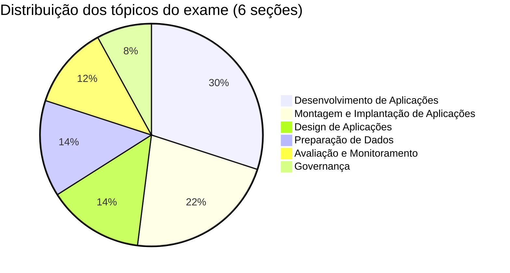

---
title: Engenheiro de IA Generativa Associate
tags:
  - databricks
  - certification
  - genai
type: certification
aliases:
  - Engenheiro de IA Generativa
---

# Databricks Generative AI Engineer Associate

> [!important]
> **O que mudou no guia atual do exame (exame publicado em 18 de março de 2026; PDF reemitido como "agosto de 2026")**
>
> - **Seis seções ponderadas**: Design de Aplicações 14 %, Preparação de Dados 14 %, Desenvolvimento de Aplicações 30 %, Montagem e Implantação de Aplicações 22 %, Governança 8 %, Avaliação e Monitoramento 12 %. O PDF de agosto de 2026 imprime esses pesos dentro do guia; os bullets de habilidades são idênticos ao PDF de março de 2026
> - **Formato da questão**: 45 questões pontuadas de múltipla escolha e seleção múltipla, além de até 10 itens sem pontuação — espere perguntas de "selecione DUAS"
> - **Novas habilidades**: **Agent Bricks** (Knowledge Assistant, Multiagent Supervisor, Information Extraction), **servidores MCP** (gerenciados, externos, personalizados), **sistemas multiagentes com Genie**, MLflow + **Agent Framework** para sistemas agentic, **juízes que exigem ground truth**, **Scorers personalizados**, **feedback de especialistas**, **Agent Monitoring**, controle de versão de prompts, memória persistente e interfaces de usuário de agentes (Apps, Slack, Teams)
> - **AI Gateway movido**: "AI Gateway (Inference Tables, Usage Tables e rate limiting)" é testado em **Avaliação e Monitoramento**, não em Governança
> - Aprovação / reprovação — **o guia do exame não publica uma pontuação numérica de aprovação**
>
> Fonte de verdade: [PDF do guia do exame (edição de agosto de 2026)](https://www.databricks.com/sites/default/files/2026-10/databricks-certified-gen-ai-associate-exam-guide-august-2026.pdf) e a [página da certificação](https://www.databricks.com/learn/certification/genai-engineer-associate). A estrutura das pastas neste guia corresponde às seis seções 1:1 (as pastas são ordenadas pelo fluxo de estudo, não pelo número da seção).

> [!note] Atualização da plataforma (outubro de 2026)
> Esta certificação é afetada mais do que qualquer outra por mudanças de produto no fim de 2026. O exame ainda testa a superfície de produto de março de 2026, então os arquivos de tópico ensinam essa superfície e marcam o que mudou:
>
> - **Knowledge Assistant** e **Supervisor Agent** se tornaram *legacy* em 2026-10-12; o **Supervisor API** atingiu o fim da vida em 2026-09-30 → [Agent Bricks](../../../../certifications/genai-engineer-associate/03-design-applications/03-agent-bricks.md)
> - Agentes em **Model Serving** e o **MLflow AgentServer** são *legacy* desde 2026-10-05; novos agentes usam o **Agent Bricks CLI** (Beta) e o **Agent Runtime** em Databricks Apps → [Compound AI Apps](../../../../certifications/genai-engineer-associate/02-assembling-and-deploying-apps/03-compound-ai-apps.md)
> - `ChatAgent` / `ChatModel` são interfaces de autoria legadas → **`ResponsesAgent`** → [Agentic Systems](../../../../certifications/genai-engineer-associate/01-application-development/05-agentic-systems-mlflow-and-genie.md)
> - **Genie Spaces** agora são **Genie Agents** (2026-07-08); **Vector Search** agora é **AI Search** (2026-06-01); o sucessor do AI Gateway é o **Unity Gateway**
> - MCP: serviços integrados são chamados via Unity Gateway em `https://<host>/ai-gateway/mcp-services/<name>`; o endpoint bare `/api/2.0/mcp/genie` deixa de funcionar em 2026-10-31 → [MCP Servers](../../../../certifications/genai-engineer-associate/02-assembling-and-deploying-apps/04-mcp-servers.md)

## Visão geral do exame

| Detalhe | Informação |
| --- | --- |
| **Certificação** | Databricks Certified Generative AI Engineer Associate |
| **Guia do exame** | Exame publicado / guia atualizado em 18 de março de 2026 — [PDF, edição de agosto de 2026](https://www.databricks.com/sites/default/files/2026-10/databricks-certified-gen-ai-associate-exam-guide-august-2026.pdf) |
| **Perguntas pontuadas** | 45 de múltipla escolha e seleção múltipla |
| **Itens sem pontuação** | Até 10 (não identificados; o tempo extra já está incluído) |
| **Duração** | 90 minutos |
| **Resultado** | Aprovação / reprovação (sem limite numérico no guia do exame) |
| **Idiomas** | Inglês, japonês, português (BR), coreano |
| **Código nos enunciados** | Python (SQL para manipulação de dados não relacionados a ML) |
| **Ajudas no teste** | Nenhuma permitida |
| **Experiência** | 6+ meses de prática com o escopo do exame no Databricks (recomendado) |
| **Recertificação** | A cada 2 anos — consulte o [Guia de renovação](../../../../shared/appendix/renewal-guide.md) |
| **Custo** | US$ 200 mais impostos aplicáveis |
| **Entrega** | Prova online monitorada (guia do exame); a página da certificação lista prova online ou em centro de testes |

## Pesos dos domínios do exame (oficiais)

| Seção do guia do exame | Peso |
| :--- | :---: |
| Seção 1: Design de Aplicações | 14 % |
| Seção 2: Preparação de Dados | 14 % |
| Seção 3: Desenvolvimento de Aplicações | 30 % |
| Seção 4: Montagem e Implantação de Aplicações | 22 % |
| Seção 5: Governança | 8 % |
| Seção 6: Avaliação e Monitoramento | 12 % |

## Tópicos de estudo

Cada `README.md` da pasta tem uma tabela de **Cobertura do Guia do Exame** que mapeia cada item do seu tópico para o arquivo que o ensina.

| Pasta | Seção do guia do exame | Peso | Foco |
| :--- | :---: | :---: | :--- |
| [01 — Desenvolvimento de Aplicações](../../../../certifications/genai-engineer-associate/01-application-development/README.md) | 3 | 30 % | Engenharia de prompts, cadeias/agentes, aumento de recuperação, runtime de busca vetorial, `ResponsesAgent` + MLflow Tracing, multiagente com Genie, seleção de modelos |
| [02 — Montagem e Implantação de Aplicações](../../../../certifications/genai-engineer-associate/02-assembling-and-deploying-apps/README.md) | 4 | 22 % | APIs de modelos fundamentais, logging do MLflow + UC registry, apps compostas, servidores MCP, controle de acesso, `ai_query()`, memória, CI/CD, Prompt Registry, interfaces de usuário |
| [03 — Design de Aplicações](../../../../certifications/genai-engineer-associate/03-design-applications/README.md) | 1 | 14 % | Padrões de RAG, especificações de entrada/saída, tarefas de modelos, componentes de cadeia, ordem das ferramentas, Agent Bricks |
| [04 — Preparação de Dados](../../../../certifications/genai-engineer-associate/04-data-preparation/README.md) | 2 | 14 % | Seleção de fontes, pacotes de extração, filtragem, chunking, embeddings, índices de Vector Search, métricas de recuperação, re-ranking |
| [05 — Avaliação e Monitoramento](../../../../certifications/genai-engineer-associate/05-evaluation-and-monitoring/README.md) | 6 | 12 % | Juízes MLflow 3 e scorers personalizados, feedback de especialistas, Agent Monitoring, inference tables, tabelas de uso do AI Gateway e limites de taxa, controle de custos |
| [06 — Governança](../../../../certifications/genai-engineer-associate/06-governance/README.md) | 5 | 8 % | UC para ativos de IA, mascaramento como guardrail, proteção contra entrada maliciosa, licenciamento, mitigação de texto problemático |

### Prática e recursos

| Recurso | Descrição |
| --- | --- |
| [Perguntas de prática](../../../../certifications/genai-engineer-associate/resources/practice-questions/README.md) | Questões práticas por tópico, incluindo conjuntos *(2026 guide)* |
| [Simulado 1](../../../../certifications/genai-engineer-associate/resources/mock-exam/README.md) | Exame completo de prática |
| [Simulado 2](../../../../certifications/genai-engineer-associate/resources/mock-exam-2/README.md) | Exame alternativo de prática |
| [Dicas de exame](../../../../certifications/genai-engineer-associate/resources/exam-tips.md) | Estratégias e dicas para o exame |
| [Revisão final](../../../../certifications/genai-engineer-associate/resources/final-review.md) | Escaneamento de revisão final antes do exame |
| [Links oficiais](../../../../certifications/genai-engineer-associate/resources/official-links.md) | Documentação e recursos |
| [Matriz de cobertura do guia do exame](./resources/exam-guide-coverage-matrix.md) | Quais questões testam cada um dos 56 itens do guia do exame |

## Preparação para entrevista

Após concluir esta certificação, explore:

- [Recurso de preparação para entrevista](../../../../shared/interview-prep/README.md) - Design de sistemas GenAI, arquitetura RAG e aplicações LLM

## Principais tecnologias

- **Mosaic AI Model Serving + Foundation Model APIs** — LLMs hospedados e modelos de embedding, pagamento por token ou throughput provisionado
- **Mosaic AI Vector Search** (agora **Databricks AI Search**) — vetor gerenciado e índice híbrido para recuperação semântica
- **Agent Framework + MLflow 3** — `ResponsesAgent`, MLflow Tracing, `mlflow.genai.evaluate()`, scorers, monitoramento de produção
- **Agent Bricks** — Knowledge Assistant, Multi-Agent Supervisor, Information Extraction (além do novo Agent Bricks CLI)
- **Genie Agents** (anteriormente Genie Spaces) — acesso natural à linguagem para dados estruturados, governado
- **MCP** — servidores gerenciados, externos e personalizados para ferramentas de agentes
- **AI Gateway / Unity Gateway** — inference tables, usage tables, limites de taxa, guardrails
- **Unity Catalog** — governança para tabelas, índices, modelos, funções, prompts e serviços MCP
- **LangChain / LangGraph** — frameworks de aplicação LLM e agentes

## Pré-requisitos

Revise esses fundamentos compartilhados:

- [Databricks Workspace](../../../../shared/fundamentals/databricks-workspace.md)
- [Unity Catalog Basics](../../../../shared/fundamentals/unity-catalog-basics.md)
- [RAG / Vector Search Basics](../../../../shared/fundamentals/rag-vector-search-basics.md)
- [MLflow Basics](../../../../shared/fundamentals/mlflow-basics.md)

Prática prática: o guia do exame sugere tarefas pequenas o suficiente para a [Databricks Free Edition](https://docs.databricks.com/aws/en/getting-started/free-edition). A Community Edition foi aposentada. A Free Edition não suporta Knowledge Assistant e permite apenas um endpoint de AI Search ([limitações](https://docs.databricks.com/aws/en/getting-started/free-edition-limitations)).

## Acompanhamento do progresso de estudo

- [ ] Traduzir metas de negócios em especificações de entrada/saída; escolher tarefas de modelos, componentes de cadeia e ordem das ferramentas
- [ ] Saber quando usar Agent Bricks: Knowledge Assistant, Multi-Agent Supervisor, Information Extraction
- [ ] Preparar dados: seleção de fontes, pacotes de extração, filtragem, chunking, Delta + índices de Vector Search, métricas de recuperação, re-ranking
- [ ] Construir cadeias e agentes; autorar com `ResponsesAgent`; rastrear com MLflow; conectar Genie em sistemas multiagentes
- [ ] Selecionar LLMs e modelos de embedding a partir de atributos, model cards e métricas de experimentos
- [ ] Implantar: registrar no UC, servir, controlar acesso (passthrough / OBO / segredos), inferência em lote com `ai_query()`
- [ ] Integrar servidores MCP gerenciados, externos e personalizados
- [ ] Operar: memória persistente, CI/CD, aliases do Prompt Registry, interfaces Apps / Slack / Teams
- [ ] Avaliar com juízes MLflow 3 e scorers personalizados; saber quais juízes exigem ground truth; usar feedback de especialistas
- [ ] Monitorar com inference tables, usage tables, limites de taxa e Agent Monitoring; controlar custos de LLM
- [ ] Governar: mascaramento como guardrail, defesas contra entrada maliciosa, licenciamento, texto problemático

## Recursos oficiais

- [Página de certificação da Databricks](https://www.databricks.com/learn/certification/genai-engineer-associate)
- [PDF do guia do exame (edição de agosto de 2026)](https://www.databricks.com/sites/default/files/2026-10/databricks-certified-gen-ai-associate-exam-guide-august-2026.pdf)
- [Desenvolva agentes na Databricks (Agent Bricks)](https://docs.databricks.com/aws/en/agents/)
- [Databricks AI Search (anteriormente Vector Search)](https://docs.databricks.com/aws/en/ai-search/ai-search)
- [Documentação do Model Serving](https://docs.databricks.com/aws/en/machine-learning/model-serving/)
- [Avaliação e monitoramento do MLflow GenAI](https://docs.databricks.com/aws/en/mlflow3/genai/eval-monitor/)
- [Governança de IA com Unity Gateway](https://docs.databricks.com/aws/en/ai-gateway/)
